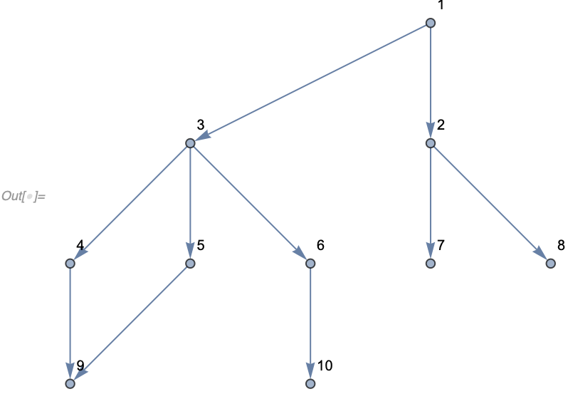
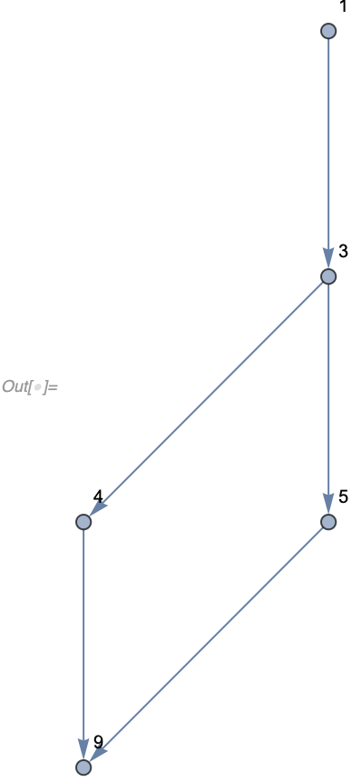

###### [Symbols and Functions](/README.md#symbols-and-functions) > Utility Functions >

# AcyclicGraphTake

**`AcyclicGraphTake`** gives the intersection of the out-component of the first vertex
with the in-component of the second vertex:

```wl
In[] := graph = BlockRandom[
  DirectedGraph[RandomGraph[{10, 10}], "Acyclic", VertexLabels -> Automatic],
  RandomSeeding -> 2
]
```

 2, 1 -> 3, 2 -> 7, 2 -> 8, 3 -> 4, 3 -> 5, 3 -> 6, 4 -> 9, 5 -> 9, 6 -> 10}, ...]">

```wl
In[] := AcyclicGraphTake[graph, {1, 9}]
```

 3, 3 -> 4, 3 -> 5, 4 -> 9, 5 -> 9}, ...]">
