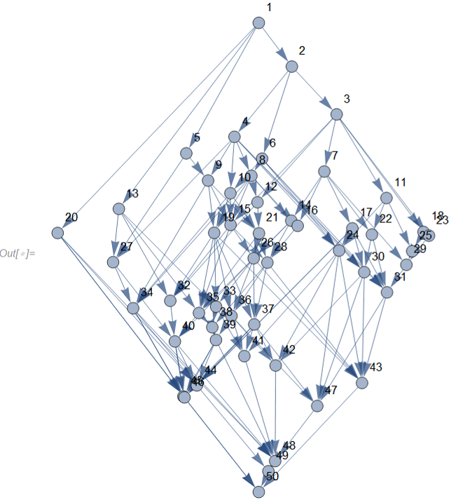

###### [Symbols and Functions](/README.md#symbols-and-functions) > Utility Functions >

# CausalDensityDimension

**`CausalDensityDimension`** estimates the dimension of a subregion of a given graph, using the Myrheim-Meyer
dimension estimation algorithm.

## Myrheim-Meyer Dimension Estimation

This method is based on [Causal Set Theory](https://en.wikipedia.org/wiki/Causal_sets), an approach to quantum gravity
which, much like the Wolfram Model, describes spacetime not as a continuum but as a large collection of discrete points
endowed with a causal partial order of the form _x_ ≺ _y_, i.e. "_x_ is to the past of _y_." A causal set then
contains a finite set of causal relations following this partial order in spacetime.

Starting from _d_-dimensional flat (Minkowski) space, the Myrheim-Meyer dimension
estimation works essentially as a box-counting method, whereby one can consider two points _p_ and _q_ in that space
that are causally connected. The Alexandrov Interval or causal diamond _A[p, q]_ is then defined to be the
intersection of the future of the event _p_ with the past of the event _q_. In this interval, define _C_<sub>_2_</sub>
to be the number of causal relations, i.e. the number of pairs _x_ ≺ _y_ between _p_ and _q_, and define
_C_<sub>_1_</sub> to be the number of events (i.e. vertices) in the interval. It is found that a suitable
ratio between _C_<sub>_2_</sub> and _C_<sub>_1_</sub> is dependent on the dimensionality _d_ into which
the causal set embeds:

$$
\frac{\langle C_2 \rangle}{\langle C_1 \rangle^2} =
  \frac{\Gamma\left(d + 1\right) \Gamma\left(\frac{d}{2}\right)}{4 \Gamma\left(\frac{3 d}{2}\right)},
$$

where _d_ is the dimensionality of the (flat) manifold. This expression comes from the fact that the probabilty
that a random choice of elements in the causal set are causally connected is directly proportional to the volume
of the region _A[p, q]_ in this set. By then evaluating an integral over this interval, one can obtain an
expectation value for the number of causal relations in that specified region. The result of this integration
is that of the right-hand side of the above expression. An explicit derivation of this result can be found in
[D. Meyer, The Dimension of Causal Sets](https://dspace.mit.edu/handle/1721.1/14328), where, note, spacetime is
defined as 1 + _d_-dimensional Minkowski space, which corresponds to _d_ in our convention for
`CausalDensityDimension`.

The right-hand side of this equation is a monotonically decreasing function, meaning that one can invert the
relationship in order to determine the dimension _d_. It is worth noting that when the events _p_ and _q_ defining
the causal diamond are either causally disconnected or are the same event, the left-hand side of the above
expression will turn to 0, meaning that the dimensionality estimation will return infinity.

```wl
sprinkledGraph = BlockRandom[Module[{coordinates, causalSet},
  coordinates = Sort[Join[{{0, 0}, {1, 1}}, RandomReal[1, {48, 2}]] . RotationMatrix[Pi / 4]];
  causalSet = RelationGraph[Abs[#2[[2]] - #1[[2]]] < #2[[1]] - #1[[1]] &, coordinates];
  TransitiveReductionGraph @
    IndexGraph[causalSet, VertexCoordinates -> ({#2, 1 - #1} & @@@ coordinates), VertexLabels -> Automatic]
], RandomSeeding -> 0]
```



```wl
In[] := CausalDensityDimension[sprinkledGraph, {1, 50}]
Out[] := 1.92705
```
