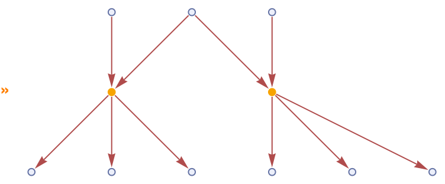
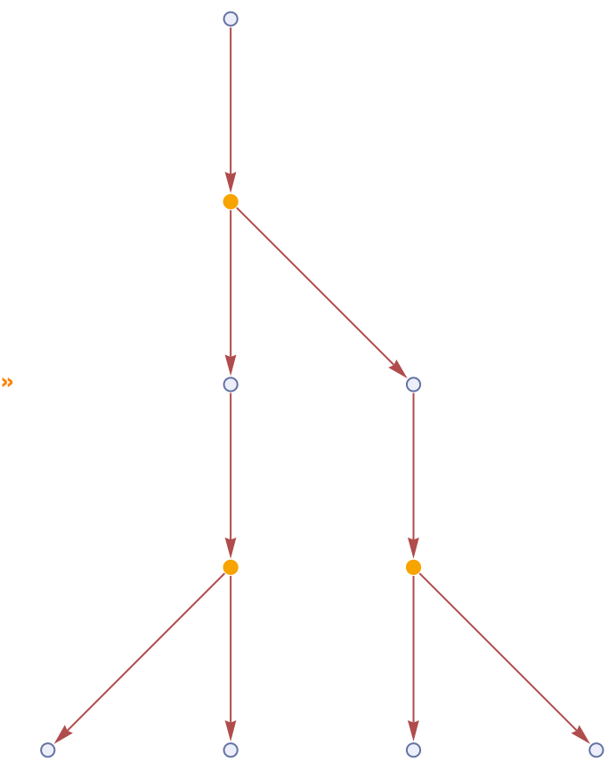

###### [Symbols and Functions](/README.md#symbols-and-functions) > [WolframModel and WolframModelEvolutionObject](../WolframModelAndWolframModelEvolutionObject.md) > [Properties](../WolframModelAndWolframModelEvolutionObject.md#properties) >

# MultiwayQ

**`"MultiwayQ"`** checks if a given evolution contains multiway branching, i.e., there is an expression used in multiple
events.

```wl
In[] := EchoFunction[#["ExpressionsEventsGraph"] &][
  WolframModel[{{1, 2}, {2, 3}} -> {{1, 2}, {2, 3}, {3, 4}},
               {{1, 2}, {2, 3}, {3, 4}},
               1,
               "EventSelectionFunction" -> "MultiwaySpacelike"]]["MultiwayQ"]
```

> Graph[...
       Two events consume the same initial {2, 3}.
       Their other inputs are {1, 2} and {3, 4}, respectively.
       The first produces {{1, 2}, {2, 3}, {3, 5}} and the second produces {{2, 3}, {3, 4}, {4, 6}}.
       The two output copies of {2, 3} are distinct expression vertices.
     ...]">

```wl
Out[] = True
```

Note that even
if [`"EventSelectionFunction"`](/Documentation/SymbolsAndFunctions/WolframModelAndWolframModelEvolutionObject/Options/EventSelectionFunction.md)
is set to allow multiway branching, the system might still be singleway if no overlapping matches occurred:

```wl
In[] := EchoFunction[#["ExpressionsEventsGraph"] &][WolframModel[
  {{1, 2}} -> {{1, 3}, {3, 2}}, {{1, 1}}, 2, "EventSelectionFunction" -> "MultiwaySpacelike"]]["MultiwayQ"]
```

> Graph[...
       {1, 1} produces {1, 2} and {2, 1}.
       The next two events use separate inputs:
       {{1, 2}} -> {{1, 3}, {3, 2}} and {{2, 1}} -> {{2, 4}, {4, 1}}.
     ...]">

```wl
Out[] = False
```
