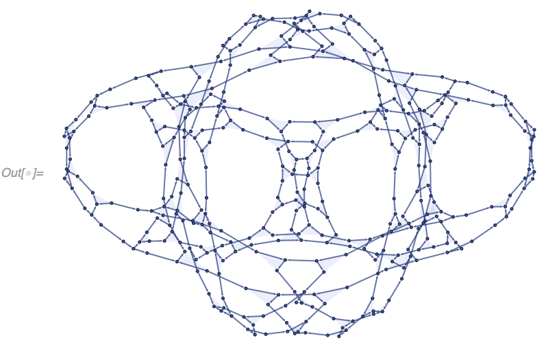
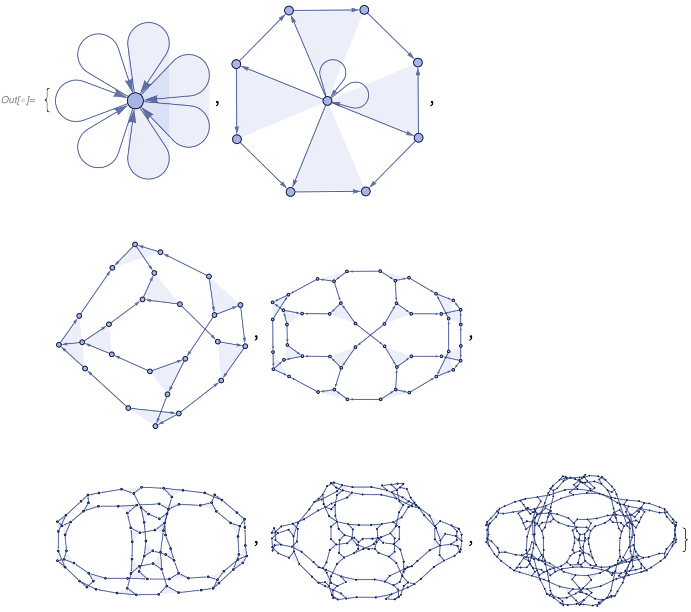
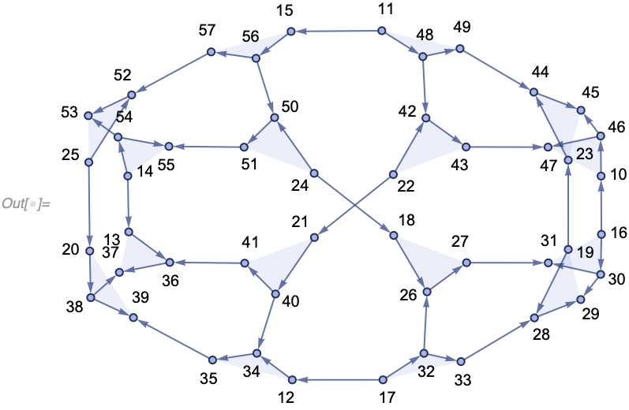

###### [Symbols and Functions](/README.md#symbols-and-functions) > [WolframModel and WolframModelEvolutionObject](../WolframModelAndWolframModelEvolutionObject.md) > [Properties](../WolframModelAndWolframModelEvolutionObject.md#properties) >

# Plots of States

Instead of explicitly calling [`HypergraphPlot`](../../HypergraphPlot.md), one can use short-hand
properties **`"FinalStatePlot"`** and **`"StatesPlotsList"`**:

```wl
In[] := WolframModel[{{1, 2, 3}, {4, 5, 6}, {1, 4}} ->
  {{2, 7, 8}, {3, 9, 10}, {5, 11, 12}, {6, 13, 14}, {8, 12}, {11,
    10}, {13, 7}, {14, 9}},
 {{1, 1, 1}, {1, 1, 1}, {1, 1}, {1, 1}, {1, 1}}, 6, "FinalStatePlot"]
```



```wl
In[] := WolframModel[{{1, 2, 3}, {4, 5, 6}, {1, 4}} ->
  {{2, 7, 8}, {3, 9, 10}, {5, 11, 12}, {6, 13, 14}, {8, 12}, {11,
    10}, {13, 7}, {14, 9}},
 {{1, 1, 1}, {1, 1, 1}, {1, 1}, {1, 1}, {1, 1}}, 6, "StatesPlotsList"]
```

>, Graphics[... generation 6, a
       symmetric mesh of 320 hyperedges, seven states including the initial state ...]}">

These properties take the same options as [`HypergraphPlot`](../../HypergraphPlot.md) (but one has to specify them in a
call to the evolution object, not `WolframModel`):

```wl
In[] := WolframModel[{{1, 2, 3}, {4, 5, 6}, {1, 4}} ->
   {{2, 7, 8}, {3, 9, 10}, {5, 11, 12}, {6, 13, 14}, {8, 12}, {11,
     10}, {13, 7}, {14, 9}},
  {{1, 1, 1}, {1, 1, 1}, {1, 1}, {1, 1}, {1, 1}}, 3]["FinalStatePlot",
  VertexLabels -> Automatic]
```


